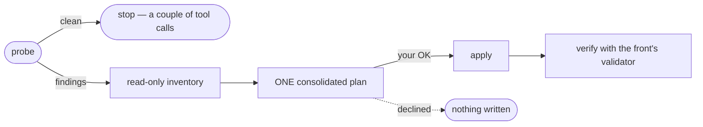

# Adopt quenching in a repository

*Audience: implementer · One OK per front · Use a disposable copy while studying the workflow*

This page describes the adoption-shaped workflow as a study. It is not evidence that the plugin is
production-ready or that its declared read-only views provide process isolation. Copy the target
first if you are learning the method or testing a change.

## Deploy the surface

quenching is installed into the target repository with `cq deploy`
([ADR 0017](../decisions/0017-install-only-by-deploy.md)). From a clone of the source repository:

```bash
python3 plugins/quenching/assets/bin/cq deploy --target <repo> --write
```

Or from a release tag through `uvx`:

```bash
uvx --from "git+https://github.com/holetz/quenching@<tag>#subdirectory=plugins/quenching" \
  cq deploy --target . --modules core --write
```

`<tag>` is a release tag such as `7.0.0` (list them with
`git ls-remote --tags https://github.com/holetz/quenching`); a literal `<tag>` fails with
`Git operation failed`. To upgrade an installed target, drop `--modules`: the recorded manifest
keeps its modules, while `--modules core` narrows a wider install and deletes the rest.

`--modules` takes `core` (default), `all` or a comma list; `--harness` takes `claude`, `codex`,
`opencode` or `none`; `--runtime uvx` writes a pinned shim instead of vendoring the runtime. The
target keeps `AGENTS.md` and `.agents/` as its source; `.agents/quenching/` and `.claude/skills/`
are generated, and every command is `/quenching-<front>-<verb>`. Deploy is installation, not
alignment: run `/quenching-knowledge-align` or `/quenching-align` after it. To upgrade, run the
same deploy from a newer checkout or tag; `--check` reports drift. See
[deploy-mode.md](../standards/architecture/deploy-mode.md).

## Uninstall or reverse

Re-run deploy with a narrower `--modules` or `--harness` to drop part of the surface, or delete
the files `.agents/.quenching-deploy.json` lists, and the manifest, to remove all of it. Neither
removes the target's `/docs/` or `.agents/quenching.json` (or the legacy `.claude/quenching.json`);
those files belong to the repository. If you need to undo an alignment, review the target's commits
and use its normal Git revert workflow. Removing the surface is not a rollback of data it already
wrote. For an upgrade regression, deploy the previous release tag again.

You have a real repository — a README that grew sideways, notes in three places, a `.claude/`
folder of one-off commands — and you want it on the canonical shape without losing anything it
already has. That is exactly what the aligns are for: **convergence over accommodation**, but
never convergence over your objection.

Every align runs the same loop:



## Decide: one front, or the aligned set

| You want | Run | It converges |
| --- | --- | --- |
| Just the knowledge base | `/quenching-knowledge-align` | `/docs/` into the OKF bundle, pulling in out-of-band content |
| Just the automation surface | `/quenching-components-align` | `.claude/` onto one file per entry point, bodies audited |
| Just the design source | `/quenching-design-align` | `/.design/` source, projections, and genres |
| Just the operations surface | `/quenching-ops-align` | the declared root, router, registry and bounded structural drift |
| Just the verification surface | `/quenching-proof-align` | the declared test gate, fixtures, layers and bounded structural drift |
| Just the toolchain surface | `/quenching-toolchain-align` | manifests, locks, pins and tool configuration |
| Just the delivery surface | `/quenching-delivery-align` | workflows, reachability, provenance and release shape |
| The whole repository | `/quenching-align` | all seven local aligned fronts, dependency order, one nested OK |

!!! tip "Recommendation"
    Default to `/quenching-align` for the study target. The fronts feed each other — a spec's
    distillation is glossary work for the knowledge front; the design front's standards feed its
    projections; the automation front's registry is a listing the knowledge front indexes; the
    operations registry feeds the proof front's entry-point check; and proof resources can feed
    documentation listings. The conductor loops across these edges until nothing changes anywhere.
    Authorization nests one level: each front align inherits your OK and never re-asks, while a
    code-coupled rename and an irreversible close still gate on their own.

## Run it

1. Start from a **clean working tree** — the plan you are about to approve should be the only
   diff you end up reviewing.
2. Type `/quenching-align`. The probe runs each applicable front's own verifier first
   (`cq knowledge validate`, `cq design doctor`, `cq components doctor`/`lint`, `cq ops doctor`,
   `cq proof doctor`, `cq toolchain doctor`, `cq delivery doctor`); a clean front stops without ceremony. `ops` and `proof` are applicable
   when `.agents/quenching.json` (or the legacy `.claude/quenching.json`) declares `ops.opsRoot` or `proof.proofRoot`, or when their fixed conventional-root
   probes find an entry point or test module. Otherwise the report says *not applicable* and
   offers the declaration path without inventing a plan.
3. Read the ONE plan per drifted front. It names every move: which stray docs fold into which
   `/docs/` home, which `.claude/` files collapse onto one entry point, what
   `AGENTS.md` keeps versus what moves into the bundle.
4. Give (or decline) the OK. Anything whose blast radius reaches **product code** confirms on
   its own even inside the conducted run — one blanket OK never covers a code-coupled rename.

## What the operations and proof fronts add

The operations front reads `ops.opsRoot` and `ops.router` from `.agents/quenching.json` (or the legacy `.claude/quenching.json`), then probes before
it inventories. It may regenerate a stale registry and make bounded structural repairs; it never
arms a write-capable entry point, chooses an undeclared router, or drives judgement findings.
`/quenching-ops-status` is the read-only report, and `/quenching-ops-entrypoint-new` is the gated
minting path for one new Python entry point.

The proof front follows the same probe-first boundary over `proof.proofRoot`. It can make bounded gate
and fixture repairs, but it does not invent layers, choose the measured surface, install CI, run
the target suite, or raise a deferred floor. `/quenching-proof-status` reports those facts without
writing, while `/quenching-proof-layer-new` creates one named layer only after its own confirmation
and separately confirms any test migration.

When an applicable root exists without a declaration, treat that as adoption work: declare the
root and router in the target repository, then run the owning front align. A present but clean
front is **conformant**; a front excluded by scope or blocked by an earlier hard failure is
**skipped**; absence of both a declaration and a conventional signal is **not applicable**.

## What the knowledge front does beyond structure

The `docs` front is the one align with a real internal loop. After the structural pass it
offers, each on its own evidence: draining the project's Claude Code memory into the bundle,
thinning `AGENTS.md` into a thin pointer over `/docs/`, and backfilling the glossary —
looping to a fixpoint until a pass changes nothing.

??? note "What 'converged' looks like on disk"
    The same tree in every adopted repository (a repo without data simply gets no `catalog/`):
    a root `/docs/index.md` with `okf_version: "0.2"`, a fixed `glossary.md`, and the
    homes `standards/`, `concepts/`, `external/`, `documentation/`, `vision/`, `catalog/`.
    The full anatomy is in [The OKF bundle](../explanation/okf-bundle.md).

## Verify

```bash
cq=.agents/quenching/bin/cq
python3 $cq knowledge validate docs          # 0 error(s) is the gate
python3 $cq components doctor --json         # "ok": true
python3 $cq components lint --json           # zero error findings
python3 $cq --root . ops doctor --json       # exit 0 is a clean operations front
python3 $cq --root . proof doctor --json     # exit 0 is a clean proof front
```

Re-running an align after a green verify is cheap by design: the probe finds nothing and stops.

**Next:** with the shape in place, put real work through it —
[drive a spec from idea to merge](drive-a-spec.md).
